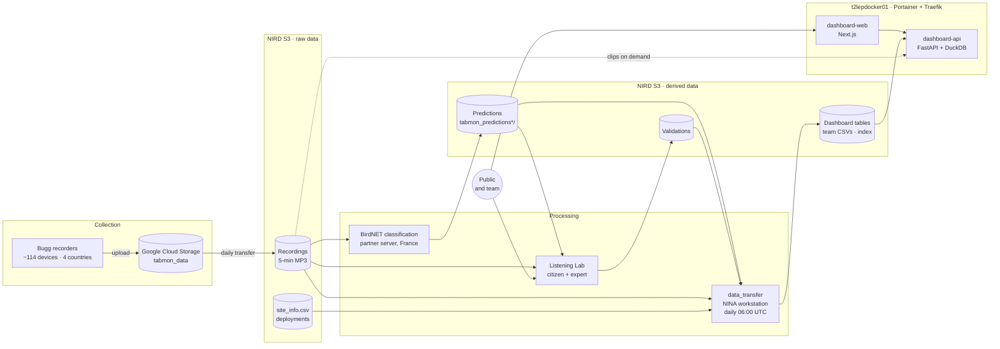
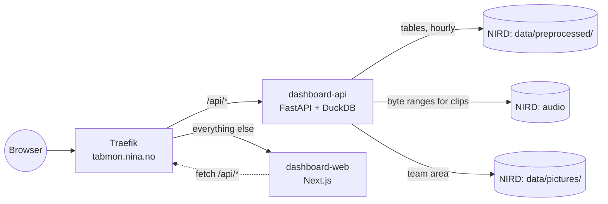
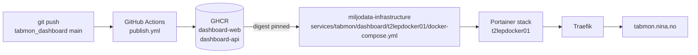

# TABMON architecture

How the TABMON acoustic monitoring network gets from a recorder in the field to the
charts on [tabmon.nina.no](https://tabmon.nina.no): which systems exist, who runs
them, where the data lives and how the pieces are built and deployed.

TABMON (2024–2026, Biodiversa+) runs about 114 autonomous recorders in Norway, the
Netherlands, France and Spain. The network continues within
[BEAGLE](https://cordis.europa.eu/project/id/101288886) (Horizon Europe, 2026–2030).

## Components at a glance

| Component | Repository | Runs on | Run by | Role |
|---|---|---|---|---|
| Bugg recorders | – | In the field | Partners per country | Record 5-minute MP3 files around the clock, upload over the mobile network |
| Google Cloud Storage | – | Google Cloud | Bugg platform | Landing bucket for uploads (`tabmon_data`) |
| NIRD S3 bucket | – | NIRD (Sigma2) | NINA | Single store for audio, metadata, predictions, validations and derived tables |
| Data pipeline | [`NINAnor/WP1-data-transfer`](https://github.com/NINAnor/WP1-data-transfer) | NINA workstation (for now), Docker, daily 06:00 UTC | NINA | Moves audio to NIRD, indexes it, builds the dashboard tables |
| BirdNET classification | `NINAnor/TABMON-classification-pipeline` | Partner server in France | French partners | Runs BirdNET on the recordings, writes the predictions to NIRD (`tabmon_predictions*/`) |
| Listening Lab (citizen and expert) | [`NINAnor/tabmon_species_api`](https://github.com/NINAnor/tabmon_species_api) | `t2lepdocker01` (Portainer) | NINA | Validation of BirdNET detections by volunteers and experts |
| Dashboard (web and API) | [`NINAnor/tabmon_dashboard`](https://github.com/NINAnor/tabmon_dashboard) (this repo) | `t2lepdocker01` (Portainer) | NINA | Public sound map and team area |
| Deployment configuration | `NINAnor/miljodata-infrastructure` | – | NINA | Portainer stacks, pinned image digests |

## Overview

Recordings flow from left to right; predictions and validations, made by other
systems, feed back into the daily pipeline.



## Data flow

### 1. Recording and upload
Each Bugg records continuous 5-minute MP3 files and uploads them to the Google Cloud
Storage bucket `tabmon_data` (rclone remote `gcs_tabmon:tabmon_data`).

### 2. Daily pipeline (`data_transfer`)
A single Docker container on a NINA workstation (for now) runs
`cron-wrapper.sh` every day at 06:00 UTC:

| Step | Script | What it does | Writes |
|---|---|---|---|
| 01 | `01_transfer/move.sh` | Moves new recordings from GCS to NIRD (rclone move) | Audio folders |
| 02 | `02_indexing/make_parquet.sh` | Incrementally rebuilds the list of all audio files (several hours) | `index.parquet` |
| 03–04 | `03_preprocessing/`, `04_upload/` | Device status, per-device statistics and the activity matrix for the team area | `data/preprocessed/*.csv` |
| 05 | `05_dashboard/build_tables.py` | Builds the dashboard's data contract: effort, phenology, thresholds, clips, names, … | `data/preprocessed/dashboard/*.parquet` |

Steps 01, 02 and 05 stop the run if they fail. Steps 03–04 are optional: if they fail,
step 05 still runs and the run is reported as failed at the end. Logs:
`data_transfer/logs/pipeline.log` on the host (`/var/log/pipeline.log` in the
container).

### 3. BirdNET classification
Partners in France run BirdNET on the recordings on their own server and upload each
run to the bucket as a complete dataset in its own folder (see
[The S3 bucket](#the-s3-bucket)). Each reader is pointed at one run:

- **Dashboard pipeline:** `PREDICTIONS_PREFIX` (environment variable of step 05),
  default `tabmon_predictions_2026_10/merged_predictions_light`: January 2025 to
  October 2026.
- **Listening Lab:** `PREDICTIONS_S3_PREFIX` (Portainer stack variable).

Both read the `merged_predictions_light/` part (detections with confidence ≥ 0.10,
one Parquet file per recorder and month). When a new run arrives, change the
prefix, rerun step 05 and redeploy the Listening Lab stacks.

Classification is **not** part of the daily pipeline: the dashboard can only show
months that have been classified.

### 4. Validation (Listening Lab)
Two Streamlit apps built from the same image read predictions and audio from NIRD:

- **Citizen** ([tabmon-listening-lab.nina.no](https://tabmon-listening-lab.nina.no)):
  open to everyone, yes/no/unsure on single species; writes `validations/`.
- **Expert** ([tabmon-listening-lab-expert.nina.no](https://tabmon-listening-lab-expert.nina.no)):
  login, full species checklist per clip from the sets in `validation_dataset/`;
  writes `validations_expert/`.

Step 05 turns these validations into per-species confidence thresholds (see
[Key rules](#key-rules)).

### 5. Dashboard
The API loads the Parquet tables and CSVs into DuckDB at start-up and reloads them
every hour, so new pipeline output appears without a redeploy. Audio clips are cut
on request from the original recordings (byte-range read of about 350 KB, ffmpeg,
in-memory cache). Column-level details are in
[`docs/data-contract.md`](docs/data-contract.md).



## The S3 bucket

Everything is stored in one bucket on NIRD (Sigma2):

- **Bucket:** `bencretois-ns8129k-proj-tabmon`
- **Endpoint:** `https://s3.nird.sigma2.no` (path-style requests, region `us-east-1`)
- **rclone remote:** `nirds3` (e.g. `rclone lsf nirds3:bencretois-ns8129k-proj-tabmon/`)

Listing the recording folders is slow (tens of thousands of files per recorder);
use `index.parquet` to find files instead.

### Layout

Sizes and counts as of November 2026.

```
bencretois-ns8129k-proj-tabmon/
│
│  ── Recordings ───────────────────────────────────────────────────────────────
├── proj_tabmon_NINA/                  Norway        65 recorders · 2.1 M files ·  9.7 TB
├── proj_tabmon_NINA_NL/               Netherlands   18 recorders · 2.1 M files · 10.3 TB
├── proj_tabmon_NINA_FR/               France        25 recorders · 2.4 M files · 11.2 TB
├── proj_tabmon_NINA_ES/               Spain         18 recorders · 2.4 M files · 11.8 TB
│   └── bugg_RPiID-<16 hex digits>/          one folder per recorder; the ID is the last 8
│       │                                    characters (e.g. bugg_RPiID-1000000002550e55)
│       └── conf_<YYYYMMDD>[<SIM>]_TABMON/   one folder per Bugg configuration
│           └── <YYYY-MM-DD>T<HH_MM_SS.mmm>Z.mp3   5-minute recording, start time in UTC
├── proj_tabmon_NINA_ES_test/          test recordings (ignored)
│
│  ── Metadata ─────────────────────────────────────────────────────────────────
├── index.parquet                      one row per audio file: Path, Name, Size, ModTime,
│                                      country, device (rebuilt daily by pipeline step 02)
├── site_info.csv                      deployments (export of the deployment form): DeploymentID,
│                                      DeviceID, Country, Cluster, Site, coordinates, begin/end dates
├── site_info_backups/                 copies of site_info.csv taken before manual edits
│
│  ── BirdNET predictions (written by the partners in France) ────────────────────
├── tabmon_predictions/                earlier run: Jan 2025 – May 2026 (superseded)
│   ├── merged_predictions_light/      confidence ≥ 0.10, one file per recorder and month
│   │   └── country=<Country>/device_id=<id>/<YYYY-MM>_<id>.parquet
│   ├── merged_predictions/            confidence ≥ 0.01, same layout, until Mar 2026 (not used)
│   ├── tabmon_predictions_<Country>.parquet   the same data, one file per country (not used)
│   ├── tabmon_predictions_light.parquet       (not used)
│   └── index_light.parquet                    (not used)
├── tabmon_predictions_2026_10/        latest run: Jan 2025 – Oct 2026 (uploaded 20 Nov 2026)  ◄ USED
│   ├── merged_predictions_light/      ◄ read by the dashboard pipeline and the Listening Lab
│   ├── merged_predictions/            confidence ≥ 0.01 (not used)
│   └── tabmon_predictions_<Country>[_light].parquet   one file per country (not used)
│
│  ── Validation (Listening Lab) ─────────────────────────────────────────────────
├── validations/                       citizen checks: session_<id>.csv
├── validations_expert/                expert checks: <dataset>_session_<id>.csv
├── validation_dataset/                expert annotation sets offered in the expert app (*.parquet)
├── completed_validation_dataset/      finished expert annotation sets
│
│  ── Site photos and derived tables ─────────────────────────────────────────────
├── data/
│   ├── pictures/<Country>/Pictures/<Site>/<…>_<device>_<view>.jpg   deployment photos
│   ├── pictures/<Country>/*.xlsx      deployment forms (some countries)
│   ├── pictures_mapping.csv           (legacy, not used)
│   └── preprocessed/
│       ├── device_status.csv          ┐
│       ├── all_device_stats.csv       │ team-area files, written by pipeline steps 03–04
│       ├── dataset_stats.csv          │
│       ├── recording_matrix.csv       ┘
│       ├── image_mapping.csv          (legacy, not used)
│       └── dashboard/                 13 Parquet tables written by pipeline step 05,
│                                      read by the dashboard API (see docs/data-contract.md)
│
│  ── Other material (not used by the dashboard) ─────────────────────────────────
├── tabmon_annotation/                 annotation packages for annotators (guide, audio zips, tables)
├── acoustic_indices_NL/               acoustic indices per recorder and period (Netherlands)
├── birdvalidator_demo/                demo audio and BirdNET results
└── ARCHIVE/                           archived Listening Lab data
```

### Who reads and writes what

| Path | Written by | Read by |
|---|---|---|
| `proj_tabmon_NINA*/` | Pipeline step 01 (moved from Google Cloud) | Step 02, BirdNET (France), Listening Lab, dashboard API (clips) |
| `index.parquet` | Pipeline step 02 | Pipeline steps 03 and 05 |
| `site_info.csv` | Field teams (deployment form); manual fixes | Pipeline steps 03 and 05, Listening Lab |
| `tabmon_predictions_2026_10/merged_predictions_light/` | BirdNET (France) | Pipeline step 05 (`PREDICTIONS_PREFIX`), Listening Lab (`PREDICTIONS_S3_PREFIX`) |
| `tabmon_predictions/` | BirdNET (France), earlier run | Nothing (superseded) |
| `validations/`, `validations_expert/` | Listening Lab | Pipeline step 05 (thresholds), Listening Lab |
| `validation_dataset/` | Validation coordinators | Listening Lab (expert) |
| `data/pictures/` | Field teams | Pipeline step 05 (`photos.parquet`), dashboard API (team area) |
| `data/preprocessed/*.csv` | Pipeline steps 03–04 | Dashboard API (team area) |
| `data/preprocessed/dashboard/` | Pipeline step 05 | Dashboard API |

Each BirdNET run is a complete dataset (every month since January 2025) in a new
folder next to the previous one. The dashboard and the Listening Lab only see a run
once their prediction prefix points to it.

## Build and deployment



- **Images:** every push builds `ghcr.io/ninanor/dashboard-web` and
  `ghcr.io/ninanor/dashboard-api` (tags `main` and `sha-<commit>`). The Listening Lab
  image is `ghcr.io/ninanor/tabmon_species_api`.
- **Deploying:** update the `@sha256:` digests in
  `miljodata-infrastructure/services/tabmon/<stack>/t2lepdocker01/docker-compose.yml`
  (through a pull request; `main` is protected) and redeploy the stack in Portainer.
- **Secrets and settings:**
  - `tabmon_rclone` (Docker secret, rclone config with the `[nirds3]` section): the
    dashboard API reads its S3 keys from it.
  - `DASHBOARD_PASSWORD`, `SESSION_SECRET` (Portainer stack variables): team-area
    login and the key that signs its session cookie.
  - Listening Lab: `S3_*` variables in its Portainer stacks.
  - Pipeline: the workstation's rclone config and a Google Cloud key file, mounted as
    secrets by `data_transfer/docker-compose.yaml`.
- **Public vs team data:** public endpoints only return coordinates rounded to about
  10 km; exact coordinates, photos and device health are behind the team login.

## Key rules

These rules span several repositories; keep them consistent when changing any part.

- **Device IDs** are compared without leading zeros: folder
  `bugg_RPiID-1000000002550e55`, form entry `2550e55` and `02550e55` are the same
  recorder (last 8 characters, lower case, zeros stripped).
- **Recordings belong to sites** through the device *and* the deployment dates, so a
  site keeps its history when its recorder is replaced and a moved recorder counts
  for the site it was at on each day. Sites are identified by country, cluster and
  site name.
- **Effort:** rates are detections per recorded hour. An hour counts as effort only
  if its recordings are in the bucket and BirdNET has analysed that day; detections
  outside such hours are dropped.
- **Thresholds** follow the BirdNET guidelines: per species, a logistic regression of
  correctness on the confidence score (with a ceiling below 100% when that predicts
  better), and the threshold is the lowest score where it reaches 90% (70% as a
  fallback). Species whose curve never reaches 70% are hidden; species without enough
  checks use 0.7.
- **Weeks** are calendar-year weeks (days 1–7 are week 1), not ISO weeks.
- **Times:** file names are UTC; charts use local time per country.

## Operations

| Task | How |
|---|---|
| Check the nightly run | `data_transfer/logs/pipeline.log` (look for `FAILED`) |
| Rerun the dashboard tables | `docker exec data_transfer-data-transfer-1 bash -lc 'source /app/.env-cron && cd /app/05_dashboard && uv run --project /app python build_tables.py --source s3://bencretois-ns8129k-proj-tabmon --out s3://bencretois-ns8129k-proj-tabmon/data/preprocessed/dashboard --names birdnet_multilingual.csv'` |
| Rerun the whole pipeline | `docker exec -d data_transfer-data-transfer-1 /app/cron-wrapper.sh` (takes several hours) |
| See new data on the site | Wait for the hourly reload, or restart the API container |
| Correct a deployment (dates, IDs) | Edit `site_info.csv` in the bucket (keep a copy in `site_info_backups/`) and in the source form; never change a `DeploymentID` that predictions already use |
| Deploy a new dashboard version | Push to `main`, wait for the Docker workflow, pin the new digests in `miljodata-infrastructure`, redeploy in Portainer |

## Known limitations

- **Predictions lag behind recordings:** months appear in the dashboard only after the
  French partners have classified them and the prediction path points to that run
  (currently up to 31 October 2026). The site states the last analysed day under
  its headline numbers.
- **The pipeline runs on a workstation:** if it is off at 06:00 UTC, that day's run is
  skipped and the data waits for the next run.
- **Listening Lab and relocations:** its site list maps one recorder per site name,
  so a replaced recorder's earlier clips are not offered and a moved recorder's clips
  appear under both of its sites.
- **Team-area CSVs** (steps 03–04) still come from older code; the activity heatmap
  already uses the newer `site_activity.parquet`.

## Further reading

- [`README.md`](README.md): what the dashboard shows and how to run it locally.
- [`docs/data-contract.md`](docs/data-contract.md): every table and column the API reads.
- `data_transfer/README.md` and `05_dashboard/README.md` in `WP1-data-transfer`:
  pipeline details, calibration and species names.
- Cretois et al. (2026), [TABMON: Design and deployment of a transnational passive
  acoustic monitoring network for European birds](https://doi.org/10.1111/2041-210x.70308),
  *Methods in Ecology and Evolution*.
